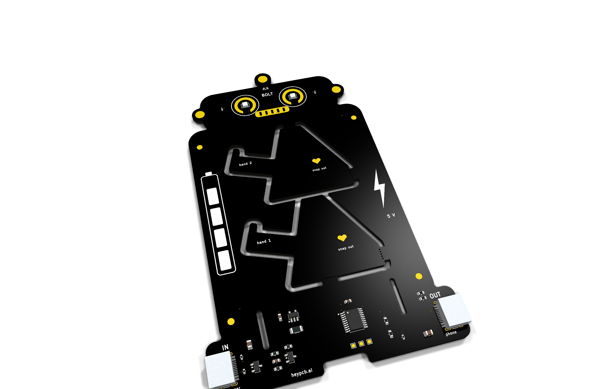
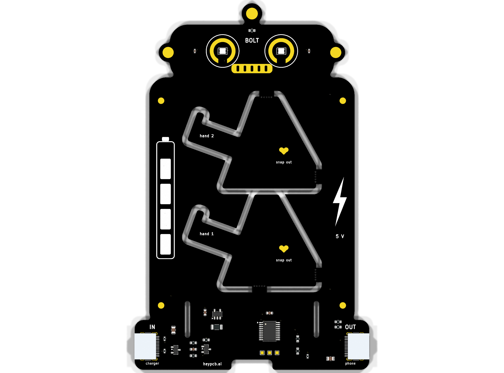
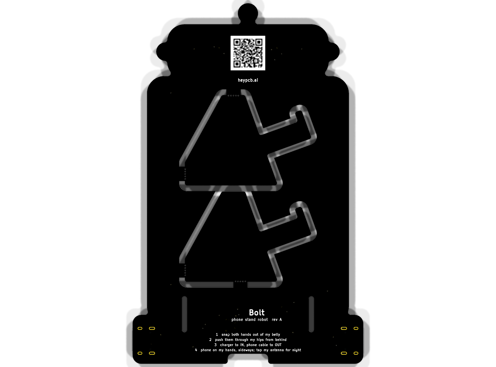

# Bolt, the phone stand robot

**A little robot that holds your phone, charges it, and peeks over the top to tell you how it's eating.**

Bolt is a matte-black robot phone stand with gold eyes. Two kickstands snap out of its belly and slot through its hips; they become the hands your phone sits on, in landscape, leaning back at 70 degrees. Your charger plugs into its left foot and your phone's cable into its right: a 5 V USB-C pass-through that powers the phone port only when a phone is attached, offers the phone what the charger can give (up to 1.5 A), and measures the charge current. Its two RGB eyes peek over the phone and show it: orange and pulsing while the phone eats, green when it is full.

| Layers | Size | Parts | Nets | Connections routed | Vias | ERC errors | DRC errors / unconnected / parity | BOM @100 |
|---|---|---|---|---|---|---|---|---|
| 2 | 80.1 x 125.4 mm | 31 (+4 pads) | 21 | 76 -> 0 open | 35 | 0 | 0 / 0 / 0 | $1.33 |

**Not fabricated, assembled or powered yet.** Every number on this page is measured by KiCad 10.0.6 on
the files in this repository ([`report.json`](report.json), [`measured.json`](measured.json)) or read
from the live JLC/LCSC catalogue ([`bom_cost.json`](bom_cost.json)).

| | |
|---|---|
| Spec, power budget, BOM | [`SPEC.md`](SPEC.md) |
| Store copy | [`STORE_COPY.md`](STORE_COPY.md) |
| KiCad 10 project | [`kicad/`](kicad/) |
| Gerbers, drill, BOM, CPL, STEP, schematic PDF | [`fab/`](fab/) |
| Firmware | [`firmware/`](firmware/) |
| Renders | [front](media/top.png), [back](media/bottom.png), [hero](media/hero.png), [Circuit World thumbnail](media/circuit-world.png) |
| Brief and generator | [`design/`](design/) |

 

## What's on it

- **USB-C in:** a 5 V sink with 5.1k Rd; the CH32V003 reads the charger's advertised current on its CC lines.
- **USB-C out:** a 5 V source with GPIO-driven Rp (22k for 1.5 A, 56k for default USB power), an AO3401A switch with soft start that turns on only after the phone's Rd is seen for 150 ms, and a 10k bleeder.
- **Current:** 20 mOhm shunt and INA180A2 (gain 50), 1 V per amp into the ADC; over-current trips the port.
- **Face:** two WS2812C-2020 eyes over the phone; the gold antenna ball is a capacitive touch pad for night mode.
- **Stand:** two snap-out kickstands (four tabs, drilled mouse bites) through 1.85 mm slots; phones up to 12.5 mm thick; no PD, 5 V only (7.5 W).

## Finish

Matte Black solder mask, White silkscreen, ENIG copper finish, 1.6 mm FR4, top-side SMT assembly (J1, J2: an SMD part whose shell legs go through plated holes, soldered on the same SMT line).
The gold art is bare copper under a mask opening (ENIG), drawn with its own keep-out so no track runs
under it. The QR code on the back opens [https://heypcb.ai/world/b/e8b0eb778647](https://heypcb.ai/world/b/e8b0eb778647).

## How it was made

Designed with the HeyPCB method on KiCad 10.0.6, headless, by the `heypcb-kicad` pipeline: a written
brief composed from reusable circuit blocks, every pin from KiCad's own symbol library, every part bound
to an LCSC number from a dated catalogue read, then ERC, a netlist round trip, locked placement,
Freerouting 2.4.1, pours, silkscreen and board art, DRC with schematic parity, DFM and a fab gate,
each stage gated by a measurement. `design/make_brief.py` regenerates the brief (outline, part
locks and art) from code.

Part of the [heypcb.ai merch collection](https://github.com/HeyPCB/merch).

## License

Hardware: [CERN-OHL-S v2](LICENSE). Firmware: MIT (see [`firmware/LICENSE`](firmware/LICENSE)). KiCad's symbol, footprint and 3D
libraries used in the design are CC-BY-SA 4.0 with the KiCad library exception.
